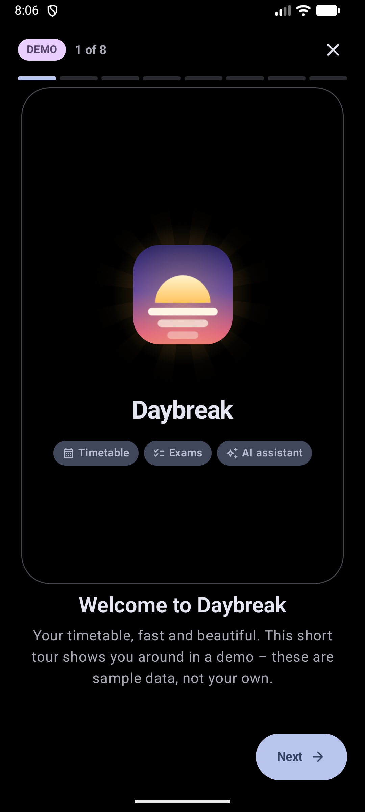
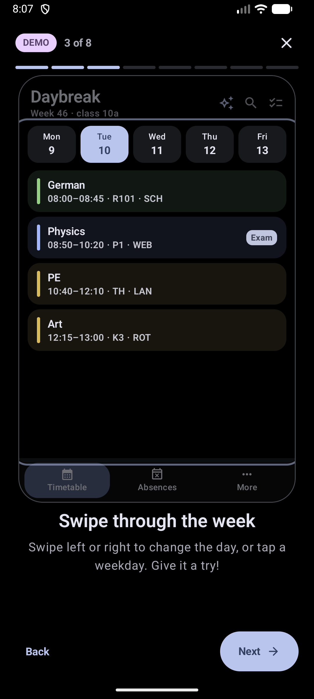
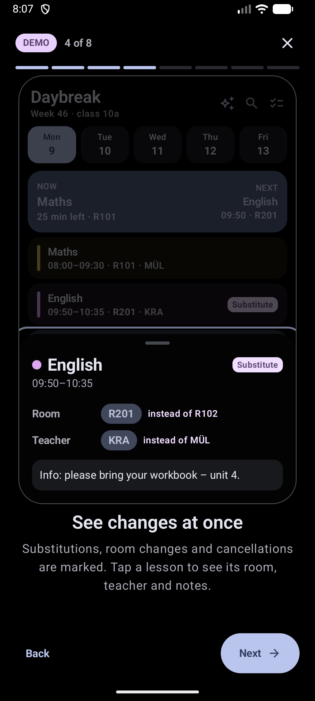
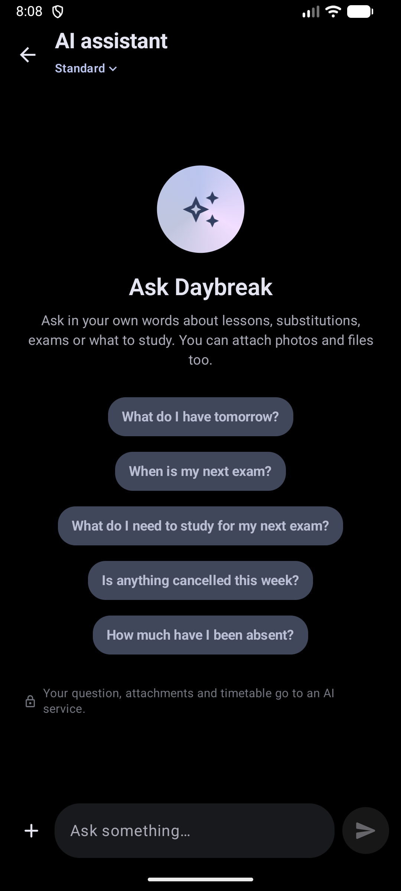
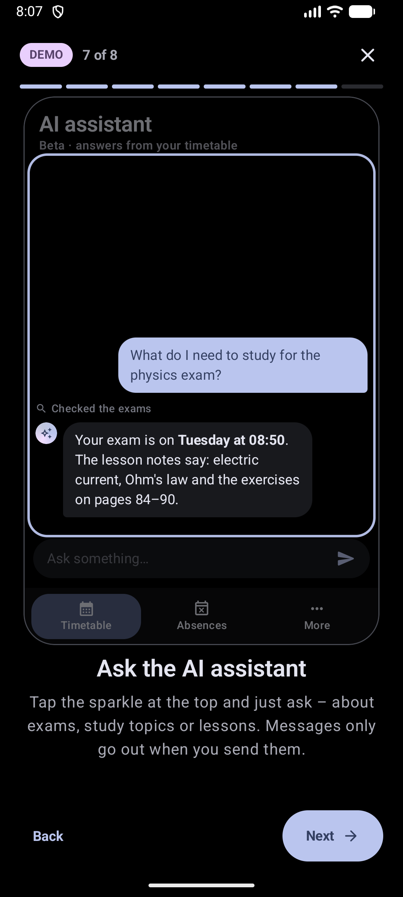
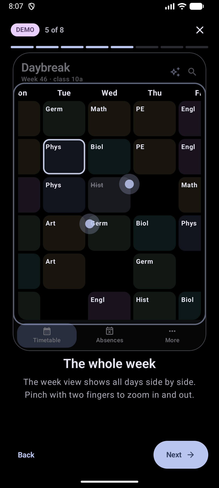
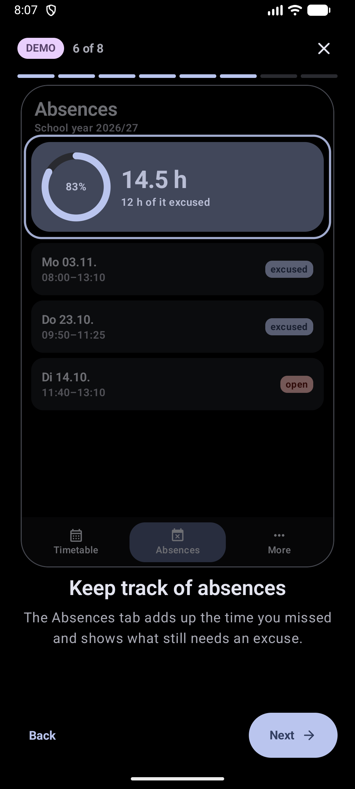
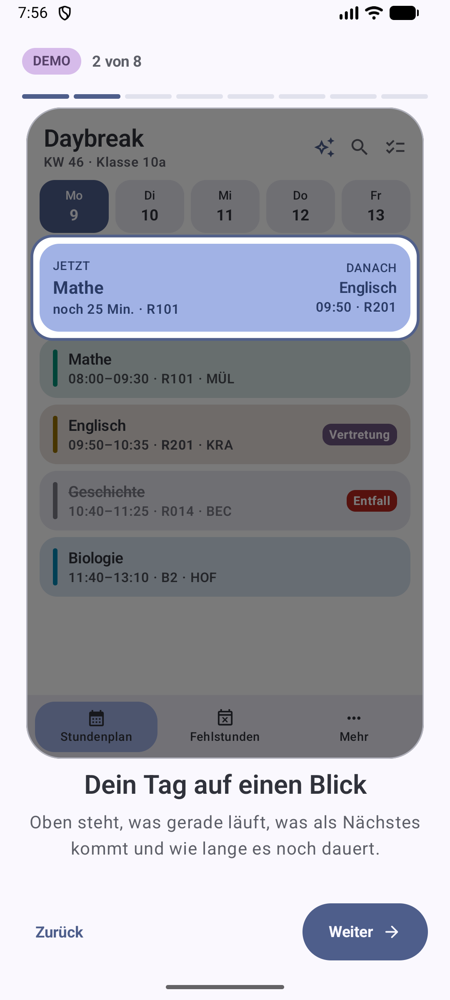
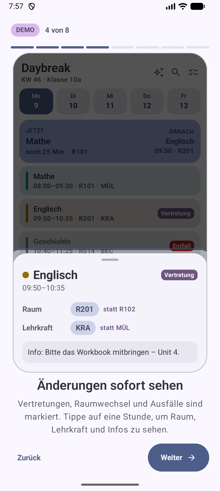
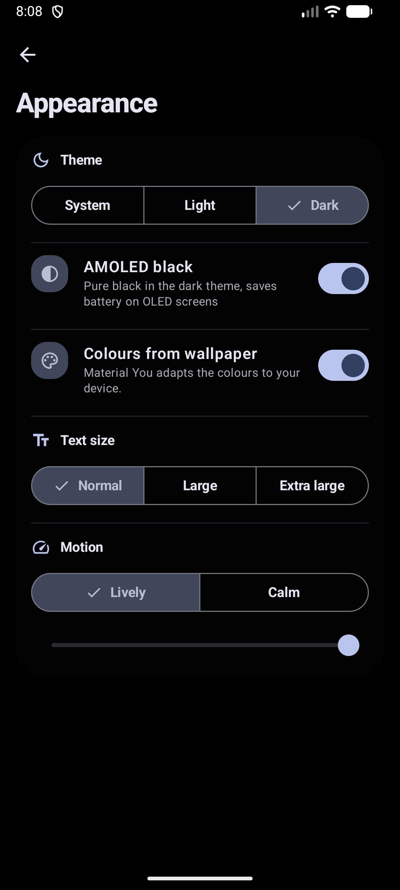

<div align="center">

# Daybreak

**A fast, good-looking, unofficial WebUntis timetable app for Android and Windows, with Dawn, an AI assistant that knows your school week.**


</div>

<p align="center">
  
  
  
  
</p>

> The timetable screenshots come from the app's built-in demo (the introduction tour), so they show sample
> data, not a real student's timetable. They were taken on an emulator from a debug build.

---

## Contents

- [Features](#features)
- [Plans and account](#plans-and-account)
- [Dawn, the AI assistant](#dawn-the-ai-assistant)
- [Introduction tour](#introduction-tour)
- [Screenshots](#screenshots)
- [Signing in](#signing-in)
- [Working on Daybreak](#working-on-daybreak)
- [Privacy and security](#privacy-and-security)
- [Licence and disclaimer](#licence-and-disclaimer)

## Features

- **Day and week views**: swipe between days, pinch to zoom, a live "now and next" card, and clear badges for
  cancellations, room changes and substitutions. Exams are framed in amber; the part of a lesson you missed is greyed out.
- **Holidays** show as a block you can open. Rooms, teachers and classes in a lesson link to their own timetable.
- **Dawn**, the AI assistant (optional): ask about your week in your own words, attach photos or PDFs, let it find
  what to study for an exam, or have it draft a message to a teacher that only you can send.
  [More below](#dawn-the-ai-assistant).
- **Daybreak account** with up to three WebUntis accounts, and the plans Free, Plus and Pro.
  [More below](#plans-and-account).
- **Introduction tour** in a demo environment, in German and English, shown once to everyone and replayable from More.
- **Homework, exams and school notices** on their own pages, plus your WebUntis **messages** (inbox, sent, drafts)
  with attachments.
- **Absences** with totals that only count time when lessons actually took place, shown as hours, minutes or
  50-minute school lessons.
- **Appearance**: system, light or dark theme, **AMOLED black**, Material You colours or one of five accent
  palettes, per-subject colours, lively or calm motion and three text sizes.
- **Offline first**: an eight-week cache, periodic sync, change notifications, a morning summary and evening
  reminders, and a Glance home-screen widget.
- **Haptics** designed per effect, with presets and fine control.
- **Windows desktop app** (Compose Multiplatform) with a one-click installer.
- German is the default UI language; English can be picked in Settings or on the login screen.

## Plans and account

Daybreak works with a **Daybreak account**: a random account id and a **restore code**, no e-mail address and no
password. Several devices can sign in to one account with the restore code. Up to **three WebUntis accounts** can be
bound to one Daybreak account; Daybreak stores only a salted hash of school and student id plus a short label you
choose.

| | Free | Plus | Pro |
| --- | :---: | :---: | :---: |
| Timetable, absences, messages, exams, homework, search, notifications, basic widget | ✓ | ✓ | ✓ |
| Dawn, with photo and PDF attachments | a few questions, basic model | more questions, more models | most questions, all models |
| App name and icon, calendar export, widget customisation, share timetable as picture | | ✓ | ✓ |
| Sync of Daybreak-only data across devices (settings, lesson colours, notes, homework ticks) | | ✓ | ✓ |
| Dawn reasoning picker and message drafts, haptics studio, accent palettes, AMOLED black | | | ✓ |

Plus and Pro are monthly subscriptions paid through **Stripe** (Stripe Checkout in the browser); Daybreak stores only
the plan and its status, never payment details. Ko-fi remains a plain donation link on the Daybreak web page and does
not buy a plan. People who supported Daybreak on Ko-fi before 2.0.0 keep their extras.

## Dawn, the AI assistant

<p align="center">
  
  
</p>

Tap the ✨ in the timetable bar (or More → Dawn) and ask, for example:

- *"What do I have tomorrow?"*, *"Is anything cancelled this week?"*
- *"When is my next exam?"*, *"What do I need to study for it?"* (it reads the teachers' lesson texts and info notes)
- *"How much have I been absent?"*
- *"Write to my maths teacher that I'm ill today."* Dawn drafts the message; **it is sent only when you tap Send on
  the draft card**.

You can attach **photos** (scaled down to 1600 px JPEG on the phone, which also drops location data) and **PDF or
text files** up to 5 MB.

How it works:

- Requests go to Daybreak, which forwards them to **[OpenRouter](https://openrouter.ai)** and the model's provider.
  No API key ships in the app.
- **Tools run on the phone**: lessons, exams, lesson notes, homework, absences, teachers and message drafts are looked
  up on the device from your WebUntis data, and the chat continues.
- Which models you can use depends on your plan. Dawn can be limited or unavailable for a while; the app then asks you
  to come back later and shows no numbers.

## Introduction tour

Every user goes through a short tour once, including people who were already signed in before it existed. It runs in
a **demo environment** inside a phone frame, with sample lessons, absences and a scripted assistant chat, so it works
before sign-in and never shows real data.

- A spotlight glides from one part of the screen to the next; days swipe on their own, the week view pinches, and the
  assistant types, so the gestures are shown, not just described.
- German and English, light, dark and AMOLED.
- Replay any time under **More → Tutorial**. A reworked tour is shown again to everyone by raising
  `TutorialProgress.VERSION`.

## Screenshots

| Day view | Lesson details | Week view | Absences |
| :---: | :---: | :---: | :---: |
|  |  |  |  |

| Light, German | Light, German | AMOLED black | Tour |
| :---: | :---: | :---: | :---: |
|  |  |  |  |

## Signing in

### With the Untis Mobile QR code

QR sign-in is the default. Tap **Andere Anmeldung** to show the manual and password methods.

1. Open WebUntis in a browser and sign in.
2. Go to **Profil → Freigaben → Zugriff über Untis Mobile** (Profile → Shares → Access via Untis Mobile).
3. Scan the displayed QR code from Daybreak's login screen.
4. Or paste the complete QR content into the **QR-Code** tab. It looks like this:

   ```text
   untis://setschool?url=https%3A%2F%2Fschool.webuntis.com&school=school&user=me&key=ABCDEFGHIJKLMNOP
   ```

Daybreak uses the `url`, `school`, `user` and `key` values. The key is a TOTP secret; Daybreak generates a fresh
six-digit code for every request, just like the mobile app.

### Manual entry

Use **Andere Anmeldung → Manuell** if you already know the server (e.g. `school.webuntis.com`), the school's short
name, your username and the Untis Mobile key.

### Password fallback

**Andere Anmeldung → Passwort** asks WebUntis once for the mobile access key using your username and password (plus a
verification code if your school uses two-factor authentication). Daybreak stores only the derived key, never your
password.

## Working on Daybreak

Daybreak is closed source from 2.0.0 and this repository is private. Notes for whoever builds it:

Requirements: Windows, JDK 17, Android SDK Platform 37. The project uses the included Gradle wrapper.

```powershell
.\gradlew.bat assembleDebug
.\gradlew.bat testDebugUnitTest
```

The debug APK is written to `app\build\outputs\apk\debug\app-debug.apk`. The server has its own tests
(`cd update-server; npm test`). The decisions behind 2.0.0 are in [`docs/v2-spec.md`](docs/v2-spec.md), and
[`CLAUDE.md`](CLAUDE.md) describes the architecture.

- `:untis`: the WebUntis protocol module (JSON-RPC, REST, TOTP, QR parsing, tolerant parsers, normalized models).
- `:shared`: logic shared by the Android and desktop apps (repositories, cache, schedule maths, Dawn's protocol,
  context builder and tools), all unit-tested.
- `:app`: the Compose app (UI, secure session storage, WorkManager jobs, notifications, the widget, Dawn and the
  introduction tour).
- `:desktop`: the Windows app (Compose Multiplatform) and its Inno Setup installer.
- `update-server/`: the Fastify service behind the apps (updates, accounts, plans, Stripe, Dawn).

## Privacy and security

- HTTPS only. Secrets are encrypted on the device; credentials and cached data are excluded from backups.
- No ads, no analytics, no crash reporting. Your WebUntis password is never stored, and your sign-in data and access
  key never leave your device.
- A Daybreak account has no e-mail and no password. Of your WebUntis accounts Daybreak stores only a salted hash of
  school and student id plus a label you choose.
- With Plus or Pro, Daybreak-only data (settings, lesson colours, notes, homework ticks) is synced with your account.
  Timetable, absences and messages are not.
- Payments run through Stripe; Daybreak stores only the plan and its status.
- **With Dawn**, your question, attachments, a timetable summary and the tools' results go through Daybreak to
  OpenRouter and the model's provider. No name, password or access key is sent. Daybreak can see a request log for at
  most 30 days (attachments only by name and size). Messages to teachers are sent only after you confirm them.
- The privacy policy and terms of use are part of the app (German and English) and must be accepted once; the app
  asks again only when the text changes. The app ships the text and fetches the current version from Daybreak's
  server without sending an identifier (the server sees the IP address). They stay readable under More → Privacy and terms.
- Signing out removes the key, the session, the cache and the debug log.

## Licence and disclaimer

Daybreak is proprietary software (all rights reserved) and an unofficial client; it is not affiliated with Untis
GmbH. WebUntis is a registered trademark of Untis GmbH. Use it with your own WebUntis account and within your school's rules. The WebUntis mobile interface is
not a public, supported API and may change without notice. AI answers can be wrong; check what matters in your
timetable.
